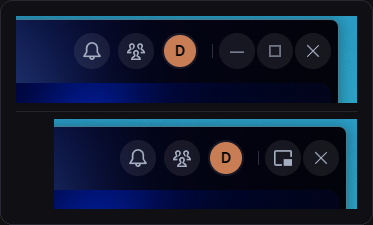

# Window Controls & Settings — Spicetify Extension

A sleek, lightweight Spicetify extension that adds customizable window controls (**Minimize**, **Maximize / Restore**, **Close**, and optional **PiP Miniplayer**) to Spotify's topbar, removes the Windows titlebar spacer for clean flush-right alignment, and provides an in-app settings modal accessible directly from your Profile menu.



## Features

- **Standard Window Controls by Default**:
  - **Minimize (`─`)**: Smoothly minimizes Spotify to the taskbar.
  - **Maximize / Restore (`🗖` / `🗗`)**: Toggles between maximized and restored states, dynamically syncing with window resize.
  - **Close (`✕`)**: Closes the window or sends Spotify to the system tray (`WINDOW_STATE_HIDDEN`).
- **Profile Menu Settings**: Click your profile avatar in the top-right corner to open **Window Controls Settings** with native Spotify Cogwheel styling.
- **Live Configuration Toggles**:
  - Toggle each button individually (Minimize, Maximize, Close).
  - Optional **Popup Player (`PiP`)** toggle (disabled by default).
  - **Auto-Minimize on PiP**: Minimizes Spotify when opening the miniplayer.
  - **Close to System Tray**: Keeps Spotify running in the notification area on close.
  - **Flush Right Alignment**: Removes Spotify's default Windows titlebar spacer and aligns items cleanly flush to the right edge.

---

## Installation

### Via Spicetify Marketplace (Recommended)
1. Open Spotify and navigate to the **Marketplace** tab in the sidebar.
2. Select the **Extensions** tab and search for **Window Controls & Settings**.
3. Click **Install**.

### Manual Installation
1. Copy `window-controls.js` into your Spicetify `Extensions` folder:
   - **Windows**: `%appdata%\spicetify\Extensions\`
   - **macOS / Linux**: `~/.config/spicetify/Extensions/`
2. Register and apply the extension:
   ```bash
   spicetify config extensions window-controls.js
   spicetify apply
   ```

## Uninstallation

To remove the extension:

```bash
spicetify config extensions window-controls.js-
spicetify apply
```
